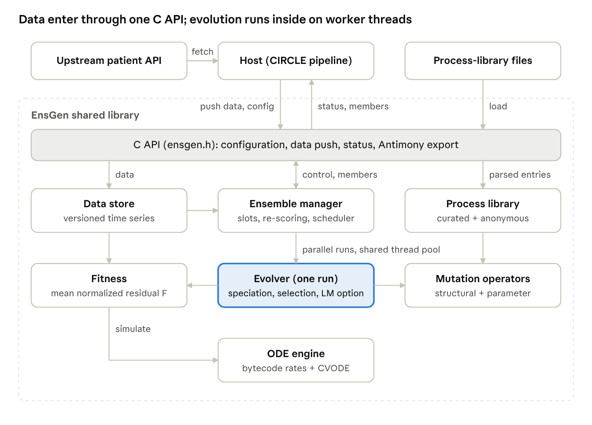

# EnsGen: Evolutionary Ensemble Generator Library — Specification

Nov 19, 2026 · @Herbert Sauro

## 1. Purpose and scope

EnsGen is a C/C++ shared library that generates an ensemble of *n* ODE models of a patient, each evolved independently until it fits the patient's longitudinal time-series data below a fitness threshold, and keeps that ensemble current as new data are pushed in. The ensemble is used the way a weather ensemble is: its spread is the forecast uncertainty.

In scope:

- Model representation and a fast ODE evaluator built on a plain data structure.
- Loading a process library written in a subset of Antimony.
- The evolutionary algorithm: speciated, mutation only, optional Levenberg–Marquardt calibration.
- Ensemble management with streaming data and the two-threshold keep/resume/replace rule.
- A C API, key–value configuration, and Antimony export of each member.
- A standalone test harness with synthetic ground-truth problems.

Out of scope:

- The tool that extracts processes from BioModels to build the process library (separate specification). This document defines only the file format both sides share.
- Data access and transport. The host fetches data from the upstream API and pushes it in.
- Uncertainty quantification on the finished ensemble (done downstream with libRoadRunner).
- GUI and language bindings. Python may be used only to cross-check results in tests.

## 2. Context and constraints

EnsGen is the ensemble generator inside the TA2 pipeline of the ARPA-H CIRCLE immune digital twin, and is linked into the larger system as a shared library.

| Constraint | Requirement |
| --- | --- |
| Language | C++17 internally; a pure C ABI at the boundary |
| Runtime dependencies | SUNDIALS CVODE only. No libRoadRunner, libAntimony or libSBML: model loading through them is too slow for the evolutionary loop |
| Platforms | Linux (GCC/Clang), Windows (MSVC 2022), macOS; WebAssembly via Emscripten must compile and pass unit tests |
| Build | CMake; produces a shared library, a static library (for unit tests) and the harness executable |
| Models | ODE only, no logical models; mass-balance form with compartments |
| Data | Longitudinal blood measurements: cell counts, cytokines, antibodies |
| Performance | At least match the existing evolver: an \~8-species model evolved in \~20 s; wall-clock time falls with core count (section 11) |
| Reproducibility | Same seed and same data give the same ensemble, independent of thread count (CURE) |
| Development | Built milestone by milestone in Claude Code; each milestone ends with passing acceptance tests (section 14) |

## 3. Architecture overview

The host is the only thing EnsGen talks to: it fetches patient data upstream, pushes it in through the C API, and reads back status and finished members.



A push creates a new data version; the ensemble manager re-scores members against it and schedules runs whose model evaluations share one pool of worker threads. Each run evolves models by mutation, drawing new processes from the process library, and scores them by simulating with the ODE engine.

## 4. Model representation

A model is a plain, copyable C++ value that the ODE function reads directly; mutation edits this structure and never reloads or recompiles a model file.

| Element | Fields |
| --- | --- |
| Compartment | name, volume. The set is fixed per handle (v1) and shared by all models |
| Species | id (entity name + compartment), compartment index, kind (observed or hidden), initial value |
| Parameter | name, value, lower bound, upper bound (bounds used on a log scale) |
| Reaction | id; consumed species + stoichiometry; produced species + stoichiometry; influencing species (affect the rate, not consumed); compiled rate expression; regulation multipliers; origin (curated process id or anonymous template id) |
| Regulation multiplier | type (linear, activation, inhibition), influencing species, its own parameters |
| Model | the above, plus a sparse stoichiometry matrix and cached per-species volumes |

### Species and compartments

A species is an entity in a compartment; `IL6_blood` and `IL6_tissue` are different species of the same entity. Observed species are those named in the data; all others are hidden. State variables are concentrations.

Initial values: hidden species carry an evolvable initial value with bounds. Observed species start at their first data value by default (`init.observed_from_data = true`); when false their initial values are evolvable too.

### Rate expressions

Rate laws are written in conventional form, e.g. reversible Michaelis–Menten as `Vm*(S - P/Keq)/(Km*(1 + S/Km + P/Kmp))`. Each is parsed once into a syntax tree and compiled to a compact postfix bytecode over three operand kinds: species index, parameter index, constant. Supported operators: `+ - * / ^`, unary minus; functions: `exp`, `log`, `sqrt`, `pow`, `abs`, `min`, `max`. A small stack interpreter evaluates the bytecode. When a reaction is inserted into a model, its parameters are copied and renamed (`J7_k`) so each reaction owns its parameters.

The full rate of a reaction is its base rate times each of its regulation multipliers:

- linear: `A`
- activation: `A^h/(K^h + A^h)`
- inhibition: `1/(1 + (I/K)^h)`

The Hill coefficient `h` is a continuous parameter, bounded to \[1, 4\] by default.

### Structural signature

Each reaction has a signature: its origin id, its bound species, and its set of (multiplier type, influencing species) pairs. A model's signature is the sorted set of its reaction signatures. Signatures are independent of reaction order and naming, and are used for speciation distance (section 7) and for comparing recovered structure with ground truth (section 13).

## 5. Process library

The process library is the set of building blocks mutation draws from: curated processes extracted from BioModels, plus anonymous processes that can connect any species to any other. Both live in text files written in a restricted subset of Antimony, read by EnsGen's own parser.

|  | Curated process | Anonymous process |
| --- | --- | --- |
| Source | A reaction extracted from a BioModels model | A generic rate form |
| Species | Named entities in fixed compartments, from the shared vocabulary | Placeholders, bound to any species when the process is inserted |
| Rate law | From the source model | Predefined |
| Parameters | Source value; default bounds = value ÷ 100 to value × 100 | Bounds required in the entry |
| Provenance | BioModels id and reaction id | None |

### File format

A file is a sequence of entries. Each entry starts with a `// @process <id>` line and holds exactly one reaction. The parser accepts only these statements; anything else is a parse error reported with file name and line number.

| Statement | Example |
| --- | --- |
| Entry header | `// @process P0042` |
| Kind | `// @kind curated`, `// @kind anonymous` or `// @kind modifier` |
| Reaction (`=>` irreversible, `->` reversible) | `J: IL6_blood => IL6_tissue; k*IL6_blood` |
| Synthesis / degradation | `J: => X; k0` and `J: X => ; kd*X` |
| Parameter value | `k = 0.3` |
| Compartment placement | `IL6_blood in blood` |
| Identity annotation | `IL6_blood identity "http://identifiers.org/uniprot/P05231"` |
| Parameter bounds | `// @bounds k 0.003 30` |
| Provenance | `// @source BIOMD0000000xxx:R5` |

Each entry stays valid Antimony, so it loads in Tellurium for checking. Events, rules, functions, units and submodels are not supported.

A curated entry:

```
// @process P0042
// @kind curated
// @source BIOMD0000000xxx:R5
IL6_blood in blood
IL6_tissue in tissue
IL6_blood identity "http://identifiers.org/uniprot/P05231"
J: IL6_blood => IL6_tissue; k*IL6_blood
k = 0.3
// @bounds k 0.003 30
```

An anonymous entry. Its species names are placeholders: reactants become consumed roles, products become produced roles, and any other species in the rate law becomes an influencing role.

```
// @process A_MMREV
// @kind anonymous
J: S -> P; Vm*(S - P/Keq)/(Km*(1 + S/Km + P/Kmp))
Vm = 1; Km = 1; Keq = 1; Kmp = 1
// @bounds Vm 1e-3 1e3
// @bounds Km 1e-3 1e3
// @bounds Keq 1e-3 1e3
// @bounds Kmp 1e-3 1e3
```

A regulation multiplier is a `modifier` entry whose rate expression is the multiplier, with `A` (or `I`) as the influencing placeholder: `J: => ; A^h/(K^h + A^h)`.

### Rate convention

Every rate expression gives concentration per time in the reaction's compartment, which is the compartment of its first consumed species, or of its first produced species when nothing is consumed. The ODE engine converts to amounts using compartment volumes (section 6). The extraction tool must convert SBML kinetic laws (amount per time) to this convention.

### Built-in anonymous library

EnsGen ships these entries embedded in the binary; a loaded file can add to or replace them.

| Id | Process | Reaction | Rate |
| --- | --- | --- | --- |
| A\_SYN | Synthesis | => X | `k0` |
| A\_DEG | Degradation / clearance | X => | `kd*X` |
| A\_CONV | Conversion (e.g. differentiation) | X => Y | `k*X` |
| A\_REVCONV | Reversible conversion | X -> Y | `k1*X - k2*Y` |
| A\_MM | Saturating conversion | S => P | `Vm*S/(Km + S)` |
| A\_MMREV | Reversible saturating conversion | S -> P | `Vm*(S - P/Keq)/(Km*(1 + S/Km + P/Kmp))` |
| A\_PROLIF | Proliferation | X => 2X | `k*X` |
| A\_LOGIST | Logistic proliferation | X => 2X | `k*X*(1 - X/Xmax)` |
| A\_KILL | Bimolecular removal | X + Y => Y | `k*X*Y` |
| A\_TRANS | Directed transport | X\_a => X\_b | `k*X_a` |
| A\_EXCH | Exchange | X\_a -> X\_b | `k*(X_a - X_b)` |
| M\_LIN | Linear multiplier | — | `A` |
| M\_ACT | Activation multiplier | — | `A^h/(K^h + A^h)` |
| M\_INH | Inhibition multiplier | — | `1/(1 + (I/K)^h)` |

Transport templates (A\_TRANS, A\_EXCH) bind the same entity in two different compartments.

### Names

Curated species names come from the shared vocabulary defined by the extraction tool. Observed species names in pushed data must match model species ids exactly; an unknown name in a data push is an error.

## 6. ODE evaluation and integration

The right-hand side is computed directly from the model structure, and integration uses CVODE with its own finite-difference Jacobian.

For reaction *j* with rate expression r\_j (concentration per time in its compartment, volume V\_rxn(j)), and species *i* in a compartment of volume V\_i:

```latex
\frac{dC_i}{dt} = \frac{1}{V_i} \sum_j N_{ij}\, r_j(C, p)\, V_{\mathrm{rxn}(j)}
```

Within one compartment the volumes cancel. For transport they make the amount leaving one compartment equal the amount arriving in the other.

### Evaluation

1. Evaluate each reaction's bytecode and multiply by its regulation multipliers.
2. Scale by the reaction volume and scatter into dC/dt through the sparse stoichiometry.
3. Divide each species' entry by its compartment volume.

No heap allocation happens inside the right-hand side.

### Integration

- CVODE, BDF method, dense direct linear solver (models are small), CVODE's internal difference-quotient Jacobian.
- Output only at the data time points.
- Each worker thread owns one CVODE instance and reuses it with `CVodeReInit`, resizing only when the number of species changes.
- Settings: `integrator.rtol`, `integrator.atol`, `integrator.max_steps`.

### Failure

A simulation fails, and the model's fitness is +∞, if CVODE returns an error, exceeds `integrator.max_steps`, produces NaN or Inf, or drives a concentration below −10 × atol. A failure never stops the run or the library.

An analytic Jacobian by automatic differentiation is deferred. It will be added only if profiling shows the Jacobian dominates run time.

## 7. Evolutionary algorithm

Each ensemble member is the best model of one independent run, and a run ends when its best fitness falls below `fitness.threshold`. Runs use a speciated population with mutation only (after PMC12047858, without crossover), implemented from scratch.

### Fitness

Fitness is the mean squared normalized residual over all non-missing data points, so its value does not grow as data are added:

```latex
F = \frac{1}{M} \sum_{i \in \mathrm{observed}} \sum_{k} \left( \frac{y_i(t_k) - d_{ik}}{\sigma_{ik}} \right)^2
```

M is the number of non-missing points, y the simulated value, d the data value. When the data supply no σ, σ\_ik = `fitness.rel_sigma` × max\_k |d\_ik| for that species. F ≈ 1 means the model fits to within the noise, so 1.0 is the natural default threshold.

An optional size penalty, `fitness.complexity_weight` × (number of parameters) / M, is added for selection only (default 0, off). The convergence test always uses the unpenalized F. A failed simulation gives F = +∞.

### One run

1. **Initialize** a population of `population.size` models. With `init.mode = random`, each model gets `init.reactions` processes drawn from the library; every observed species appears in at least one reaction. With `init.mode = seed`, each model is a mutant of a seed model supplied with `ens_add_seed_model`.
2. **Evaluate** every model's fitness, in parallel on the thread pool (section 11).
3. **Speciate.** Assign each model to the first niche whose representative is within `speciation.distance_threshold`; otherwise found a new niche. Representatives are carried over from the previous generation.
4. **Allocate offspring** to niches in proportion to the niche's mean of 1/(1 + F). A niche with no improvement for `speciation.stagnation_generations` is removed, unless it holds the run's best model.
5. **Select parents** within each niche: the best `selection.survival_fraction`. The best `selection.elites_per_niche` models pass unchanged; the run's best model always survives.
6. **Reproduce.** Each offspring is a copy of a parent with one mutation event (below).
7. **Calibrate (optional).** If `lm.enabled` and the event was structural, run up to `lm.max_iterations` Levenberg–Marquardt steps on the log parameters, with a finite-difference Jacobian of the residuals, and keep the result.
8. **Terminate.** Stop when best F < `fitness.threshold`: converged, and the best model becomes the member. Stop at `run.max_generations` without converging: the run is abandoned and a new one starts.

Speciation distance between models a and b, from their structural signatures (section 4):

```latex
\delta(a,b) = \frac{|S_a \,\triangle\, S_b|}{\max(|S_a|, |S_b|)}
```

### Mutation events

With probability `mutate.structural.prob` the event is structural; otherwise it is a parameter mutation.

Parameter mutation: each parameter (including evolvable initial values) is perturbed with probability `mutate.param.per_param_prob` by p ← p · exp(s · N(0,1)), s = `mutate.param.scale`, then clamped to its bounds.

Structural mutation chooses one operator by weight:

| Operator | Action | Weight key |
| --- | --- | --- |
| Add reaction | Draw a curated process (probability `mutate.curated_fraction`) or an anonymous one. Bind anonymous roles to existing species, or to a new hidden species with probability `mutate.new_hidden_species.prob`. A curated process adds any of its species the model lacks. Parameters start at source values (curated) or log-uniform within bounds (anonymous) | `mutate.add_reaction.weight` |
| Remove reaction | Delete a random reaction | `mutate.remove_reaction.weight` |
| Change rate law | Replace an anonymous reaction's template with another of the same role signature, keeping bindings | `mutate.change_ratelaw.weight` |
| Add regulator | Attach a linear, activation or inhibition multiplier with a random influencing species | `mutate.add_regulator.weight` |
| Remove regulator | Detach a random multiplier | `mutate.remove_regulator.weight` |
| Add transport | Connect an entity to another compartment through A\_TRANS or A\_EXCH, creating the hidden species there if needed | `mutate.add_transport.weight` |

After any structural mutation, hidden species with no reactions and unused parameters are removed. An operator whose result would exceed `network.max_reactions` or `network.max_hidden_species`, or has nothing to act on, is redrawn.

### Determinism

Every random decision in a run comes from that run's own random stream (section 11), so a run's result depends only on the seed, its slot and attempt number, and the data.

## 8. Ensemble lifecycle and streaming data

The first data push starts generation in the background. Upstream keeps pushing new data until EnsGen reports that it is complete, and each push re-scores the ensemble against the full dataset.

### Handle states

| State | Meaning | Entered by |
| --- | --- | --- |
| CONFIGURING | Library, compartments, observed species and configuration may be set | `ens_create` |
| RUNNING | Worker threads are evolving members | First `ens_push_data`, or a push while COMPLETE |
| COMPLETE | All *n* members are below `fitness.threshold` on the current data | Scheduler |
| STOPPED | Halted by `ens_stop`, or `ensemble.max_failed_runs` reached | Host or scheduler |

Configuration calls outside CONFIGURING return `ENS_ERR_STATE`.

### Data store

Each push is copied into the data store. Points at new times are appended; points at an existing time replace the old values. Every push increments the data version. Workers pick up a new version at their next generation boundary, then re-evaluate their whole population against the full dataset before continuing.

### Member slots

The ensemble has `ensemble.size` slots. Each slot is EMPTY, EVOLVING (a fresh run), RESUMING (a run seeded from an earlier member) or CONVERGED. When the data version changes, each CONVERGED member is re-scored:

| Re-scored F | Action |
| --- | --- |
| Below `fitness.threshold` | Keep the member |
| Between `fitness.threshold` and `fitness.kill_threshold` | RESUMING: a run whose population is the member plus mutants of it, limited to `run.resume_max_generations` |
| At or above `fitness.kill_threshold` | Discard; EVOLVING from scratch |

A RESUMING run that hits its generation limit is discarded and replaced by a fresh EVOLVING run. A fresh run that hits `run.max_generations` is restarted with a new attempt number; each such abandonment counts toward `ensemble.max_failed_runs`.

### Completion

The handle is COMPLETE when every slot is CONVERGED on the latest data version. Upstream stops pushing at that point. A later push returns the handle to RUNNING, and the same re-scoring rules apply.

### Data request

`ens_get_data_request` tells the host what to fetch: the observed species list, `data.t_start`, `data.t_end` and `data.n_points`. In v1 these echo the configuration. The call exists so that a later version can ask for different data without an API change. Pushed data may carry any time points; `times` is always explicit.

## 9. Configuration

All settings are named keys with documented defaults, so a handle runs with no configuration at all. They are set with `ens_set_int`, `ens_set_double`, `ens_set_bool` and `ens_set_string`, or loaded from a text file of `key = value` lines (`#` starts a comment). New keys can be added without breaking binary compatibility. An unknown key or a value of the wrong type is an error.

The defaults below are starting values to be tuned during milestones M5–M7.

| Key | Type | Default | Meaning |
| --- | --- | --- | --- |
| `ensemble.size` | int | 20 | Number of members *n* |
| `ensemble.max_failed_runs` | int | 100 | Abandoned runs before the handle stops with an error |
| `run.max_generations` | int | 2000 | Generation limit for a fresh run |
| `run.resume_max_generations` | int | = `run.max_generations` | Generation limit for a resumed run |
| `population.size` | int | 100 | Models per run |
| `init.mode` | string | `random` | `random` or `seed` |
| `init.reactions` | int | 6 | Reactions per model at initialization (random mode) |
| `init.observed_from_data` | bool | true | Observed initial values taken from the first data point |
| `fitness.threshold` | double | 1.0 | Convergence threshold on F |
| `fitness.kill_threshold` | double | 5.0 | Discard threshold after new data; must be ≥ `fitness.threshold` |
| `fitness.rel_sigma` | double | 0.1 | Default σ as a fraction of each species' maximum data value |
| `fitness.complexity_weight` | double | 0 | Size penalty used in selection only |
| `selection.survival_fraction` | double | 0.3 | Fraction of each niche kept as parents |
| `selection.elites_per_niche` | int | 1 | Models copied unchanged per niche |
| `speciation.distance_threshold` | double | 0.3 | Niche membership threshold on δ |
| `speciation.stagnation_generations` | int | 50 | Generations without improvement before a niche is removed |
| `mutate.structural.prob` | double | 0.1 | Probability an offspring gets a structural mutation |
| `mutate.param.per_param_prob` | double | 0.3 | Per-parameter mutation probability |
| `mutate.param.scale` | double | 0.2 | Log-normal step size s |
| `mutate.curated_fraction` | double | 0.5 | Probability an added reaction is curated |
| `mutate.new_hidden_species.prob` | double | 0.2 | Probability a role binds a new hidden species |
| `mutate.add_reaction.weight` | double | 1 | Structural operator weight |
| `mutate.remove_reaction.weight` | double | 1 | Structural operator weight |
| `mutate.change_ratelaw.weight` | double | 1 | Structural operator weight |
| `mutate.add_regulator.weight` | double | 1 | Structural operator weight |
| `mutate.remove_regulator.weight` | double | 1 | Structural operator weight |
| `mutate.add_transport.weight` | double | 0.5 | Structural operator weight |
| `network.max_reactions` | int | 30 | Size limit |
| `network.max_hidden_species` | int | 5 | Size limit, total across all compartments |
| `lm.enabled` | bool | false | Levenberg–Marquardt calibration after structural mutation |
| `lm.max_iterations` | int | 10 | LM iteration budget |
| `data.t_start` | double | 0 | Requested start time |
| `data.t_end` | double | 0 | Requested end time (0 = not set) |
| `data.n_points` | int | 0 | Requested number of points (0 = not set) |
| `integrator.rtol` | double | 1e-6 | CVODE relative tolerance |
| `integrator.atol` | double | 1e-9 | CVODE absolute tolerance |
| `integrator.max_steps` | int | 5000 | Step budget per simulation |
| `rng.seed` | int | 1 | Master seed |
| `threads` | int | 0 | Cores EnsGen may use (size of its thread pool); 0 = all hardware threads |
| `log.level` | string | `warn` | `error`, `warn`, `info` or `debug` |
| `log.file` | string | empty | Log file path; empty = no log. Test-only: \`debug.push\_at\_generation\` (int list) applies queued pushes at fixed generation counts (section 11) |

Compartments and observed species are set through API calls (section 10), not keys, because they are structured lists.

## 10. C API

The public interface is one header, `ensgen.h`, with C linkage, opaque handles and integer status codes. No C++ exception crosses it. Every function is safe to call from any host thread; the handle serializes access internally.

```c
#include <stdint.h>

typedef struct ens_handle ens_handle;

enum {
    ENS_OK = 0, ENS_TIMEOUT = 1,
    ENS_ERR_ARG = -1, ENS_ERR_STATE = -2, ENS_ERR_PARSE = -3,
    ENS_ERR_IO = -4, ENS_ERR_NOMEM = -5, ENS_ERR_INTERNAL = -6
};

enum { ENS_CONFIGURING, ENS_RUNNING, ENS_COMPLETE, ENS_STOPPED };

/* lifecycle */
const char* ens_version(void);
ens_handle* ens_create(void);
void        ens_destroy(ens_handle* h);      /* stops workers, frees all */
const char* ens_last_error(ens_handle* h);   /* message for the calling thread */
void        ens_free(void* p);               /* frees memory returned by EnsGen */

/* configuration (CONFIGURING only) */
int ens_set_int   (ens_handle* h, const char* key, int64_t v);
int ens_set_double(ens_handle* h, const char* key, double v);
int ens_set_bool  (ens_handle* h, const char* key, int v);
int ens_set_string(ens_handle* h, const char* key, const char* v);
int ens_get_int   (ens_handle* h, const char* key, int64_t* out);
int ens_get_double(ens_handle* h, const char* key, double* out);
int ens_get_bool  (ens_handle* h, const char* key, int* out);
int ens_get_string(ens_handle* h, const char* key, char** out);   /* ens_free */
int ens_load_config(ens_handle* h, const char* path);

int ens_add_compartment(ens_handle* h, const char* name, double volume);
int ens_set_observed_species(ens_handle* h, int n, const char** ids); /* model species ids */
int ens_load_process_library(ens_handle* h, const char* path);
int ens_load_process_library_string(ens_handle* h, const char* text);
int ens_add_seed_model(ens_handle* h, const char* antimony_subset_text);

/* data */
typedef struct {
    int          n_species;
    const char** species;
    double       t_start, t_end;
    int          n_points;
} ens_data_request;   /* pointers owned by the handle */

typedef struct {
    int            n_species;
    const char**   species;
    int            n_points;
    const double*  times;    /* n_points */
    const double*  values;   /* n_points x n_species, row-major */
    const double*  sigma;    /* optional, same shape; NULL = default */
    const uint8_t* missing;  /* optional, same shape; 1 = missing */
} ens_timeseries;

int ens_get_data_request(ens_handle* h, ens_data_request* out);
int ens_push_data(ens_handle* h, const ens_timeseries* ts); /* copies; returns at once */

/* run control */
typedef struct {
    int     state;
    int     n_target, n_converged, n_evolving, n_resuming;
    int     n_failed_runs;
    int64_t data_version;
    double  best_fitness, worst_member_fitness;
} ens_status;

int ens_get_status(ens_handle* h, ens_status* out);
int ens_wait(ens_handle* h, int timeout_ms);  /* ENS_OK when COMPLETE, else ENS_TIMEOUT */
int ens_stop(ens_handle* h);

/* results: a snapshot of CONVERGED members, valid at any time */
int ens_get_member_count(ens_handle* h, int* n);
int ens_get_member_fitness(ens_handle* h, int i, double* f);
int ens_export_member_antimony(ens_handle* h, int i, char** text);   /* ens_free */
int ens_simulate_member(ens_handle* h, int i,
                        int n_times, const double* times,
                        int n_species, const char** species,
                        double* out);   /* n_times x n_species, caller-allocated */
```

Rules:

- Input arrays and strings are copied before the call returns; the caller may free them immediately.
- Strings are UTF-8.
- `ens_simulate_member` produces forecasts: simulate each member past the last data time and read the spread across members.
- The member index refers to the current snapshot; call `ens_get_member_count` first. A member replaced after the snapshot is still returned consistently within one call.

## 11. Threading, reproducibility and errors

Parallelism works at two levels, both in v1: runs for different members execute at the same time, and within each run the model evaluations of a generation run in parallel. Both draw on one thread pool whose size the host sets with `threads`, so EnsGen uses exactly the cores it is given.

### Threading

- **Core count.** `threads` sets the number of worker threads, i.e. the cores EnsGen may use; 0 means all hardware threads. Apart from one lightweight scheduler thread, EnsGen creates no other threads.
- **Tasks.** One task evaluates one model: simulate, compute F, and run the LM calibration when enabled. Each active run submits its generation's offspring to the pool as a batch and waits for them. Its serial steps (speciation, selection, mutation) are cheap by comparison.
- **Runs.** The scheduler keeps as many runs active as there are unfinished slots, up to `threads`. When fewer runs remain than cores (the last few members, or a few resumed runs after new data), the free cores take evaluation tasks from the remaining runs, so cores do not sit idle.
- **Per-worker state.** Each worker owns one CVODE instance and its evaluator scratch space, so tasks allocate no memory.
- **Data.** The data store is versioned and read-only to workers; a push creates a new version rather than editing one in use.
- **WebAssembly.** One worker by default; the same pool when built with pthreads.
- **Checks.** All shared state is covered by ThreadSanitizer-clean tests (M7, M8).

### Random numbers

- EnsGen implements its own generator (xoshiro256\*\*) and its own uniform and normal samplers. Standard-library distributions are not used: their output differs between GCC, Clang and MSVC.
- Each run's stream is seeded by SplitMix64 from (`rng.seed`, slot index, attempt number). Results therefore do not depend on thread count or scheduling.
- Evaluation tasks use no random numbers, and write their results back by model index, so the order in which tasks finish never affects the result.

### What is reproducible

- **Batch mode** (all data pushed before the first generation): the same seed and data give a bitwise-identical ensemble on the same binary and platform, for any thread count. Across platforms, results agree within integrator tolerance but not bitwise.
- **Streaming mode**: when a push lands relative to a run's generations depends on wall-clock time. For tests, `debug.push_at_generation` makes pushes take effect at fixed generation counts, which restores determinism.

### Errors

- Every API function returns a status code; `ens_last_error` gives a message for the calling thread.
- Parse errors name the file (or `<string>`) and line number.
- Failures inside a run (failed simulations, abandoned runs) are counted in `ens_status`, never raised to the host.
- Internal errors are caught at the API boundary and returned as `ENS_ERR_INTERNAL`; the handle moves to STOPPED.

## 12. Model export

Each member exports as a complete Antimony model that loads in Tellurium and reproduces EnsGen's trajectory to within integrator tolerance. SBML is produced downstream from the Antimony.

The export contains:

- a header comment: EnsGen version, process-library hash, `rng.seed`, slot, attempt, data version and fitness;
- compartments with volumes;
- species with compartment and initial value;
- reactions with rate laws in conventional form, regulation multipliers written out inline, and the volume factor of section 6 made explicit where compartments differ;
- parameter values;
- `identity` annotations and `// @source` comments carried over from curated processes.

The same restricted-Antimony parser reads exported models back, so an export can be used as a seed model (`ens_add_seed_model`).

## 13. Test harness

The harness tests EnsGen as the integrating system will use it: a C++ executable, `ensgen_harness`, that links only the shared library and calls only the C API. Unit tests sit beside it and link the static library to reach internals.

### Parts

| Part | What it does |
| --- | --- |
| Unit tests | doctest (single header), one suite per module, run by CTest |
| C ABI check | A small program written in C (not C++) that exercises every API function |
| Synthetic data generator | Simulates a ground-truth Antimony model with EnsGen's own engine, adds Gaussian noise (relative σ, seeded), writes CSV |
| Mock upstream | Reads a scenario file (ground-truth CSV and a push schedule), pushes data through `ens_push_data`, polls `ens_get_status` |
| Evaluator | Reports fitness per member; structural overlap with the ground truth (Jaccard index of signatures); forecast calibration on held-out later points (interval coverage, rank histogram, CRPS); timings |
| Cross-check scripts | Python with Tellurium/COPASI, used only to verify trajectories and exported models |

The harness writes a JSON report and CSV trajectories for each scenario.

### Scenario file

```
ground_truth   = models/two_compartment.ant
process_library = libs/test_curated.ant
config         = configs/default.cfg
noise_rel_sigma = 0.1
noise_seed     = 7
holdout_points = 3
push = 0..5        # data points in the first push
push = 6..8 @gen 200
push = 9..11 @gen 400
```

### Reference problems

| Id | Problem | Purpose |
| --- | --- | --- |
| R1 | Three-species linear chain, one compartment | Smallest structure-recovery test |
| R2 | \~8-species model from the existing evolver's benchmark | Performance comparison with current software |
| R3 | Two-compartment model with transport and a hidden species | Volumes, transport, hidden species |
| R4 | Model built only from a small hand-made curated library | Curated processes and provenance |
| R5 | Saturating and regulated kinetics (activation, inhibition) | Multipliers and Hill parameters |

The hand-made curated library (`libs/test_curated.ant`) imitates the extraction tool's output, so EnsGen can be tested before that tool exists.

## 14. Milestones and tests

The work is eleven milestones built in order, each a self-contained Claude Code task that is done only when its acceptance tests pass in CI on Linux, Windows and macOS. Tests from earlier milestones must keep passing.

| Milestone | Delivers | Tested through |
| --- | --- | --- |
| M0 | Project skeleton, CI, configuration store, C API stubs | C API |
| M1 | Expression compiler and model data structure | Internals |
| M2 | Process-library parser and built-in anonymous library | Internals |
| M3 | ODE engine, CVODE integration, Antimony export | Internals + Tellurium |
| M4 | Data store and fitness | Internals |
| M5 | Mutation operators and a single run without speciation | Internals |
| M6 | Speciation, full run, optional LM | Internals + harness |
| M7 | Ensemble manager, threading, batch data | C API + harness |
| M8 | Streaming data and the two-threshold lifecycle | C API + harness |
| M9 | Full harness, reference problems, forecast evaluation | Harness |
| M10 | Integration release and WebAssembly build | C API |

### M0 — Skeleton

CMake project; `ensgen.h`; `ens_create`/`ens_destroy`; key–value store with every key of section 9; config file loader; status codes and `ens_last_error`; CI on three platforms plus an Emscripten compile.

- [ ] Set and get every key with its type; defaults match section 9
- [ ] Unknown key, wrong type and out-of-range value each return `ENS_ERR_ARG` with a message naming the key
- [ ] Config file: comments, blank lines and a malformed line (error names the line number)
- [ ] The C ABI check program compiles as C and links
- [ ] Emscripten build compiles

### M1 — Expressions and model structure

Expression parser, bytecode compiler and interpreter; model, species, parameter and reaction types; structural signature.

- [ ] At least 50 expressions evaluate to the same value as a reference evaluation within 1e-14 relative, including precedence, right-associative `^`, unary minus and every function
- [ ] Malformed expressions give an error with the column
- [ ] Copying a model and mutating the copy leaves the original unchanged
- [ ] Signatures are equal under reaction reordering and parameter renaming, and differ when any binding or multiplier differs
- [ ] Microbenchmark: rate evaluation of R2 recorded as the performance baseline

### M2 — Process library

Restricted-Antimony parser (section 5); built-in anonymous library embedded in the binary; loading from file and string.

- [ ] The built-in library parses with every entry and bound as in section 5
- [ ] `libs/test_curated.ant` parses; provenance, identities and compartments are kept
- [ ] Each unsupported statement and malformed entry is rejected with file and line number
- [ ] Missing bounds in an anonymous entry is an error; curated entries get the default ÷100/×100 bounds
- [ ] Every entry in both libraries loads in Tellurium (cross-check script)

### M3 — ODE engine and export

Right-hand side of section 6; CVODE wrapper with per-thread reuse; failure detection; Antimony export.

- [ ] Exponential decay, a linear chain A → B → C and logistic growth match analytic solutions within 1e-6 relative
- [ ] Two compartments of different volumes with transport: total amount conserved within 1e-9 relative
- [ ] Five test models match libRoadRunner trajectories within 1e-5 relative
- [ ] A blow-up model and a step-limit model return a failure, not a crash, and leave the worker usable
- [ ] Exported models of R1–R5 reproduce EnsGen's trajectories in Tellurium within 1e-5 relative
- [ ] Export → parse → export gives identical text

### M4 — Data and fitness

Data store with versioning and merge rules; fitness of section 7.

- [ ] F = 0 for data simulated from the model itself without noise
- [ ] F matches a hand-computed value on a small example, with and without σ and missing values
- [ ] Pushing the same data twice leaves F unchanged; duplicating every point leaves F unchanged
- [ ] A push at an existing time replaces values; at a new time appends; the data version increments
- [ ] Unknown species names and mismatched array sizes are rejected

### M5 — Mutation and a single run

All mutation operators; one run with simple truncation selection, no speciation yet.

- [ ] Property test: 10,000 random mutations on random models always give a valid model within size limits and parameter bounds
- [ ] Each operator is exercised and does what section 7 says (operator-level tests)
- [ ] Parameter recovery: true R1 structure with perturbed parameters converges below threshold
- [ ] Same seed gives an identical run; a different seed gives a different run

### M6 — Speciation, full run, LM option

Niches, offspring allocation, stagnation, elitism; optional Levenberg–Marquardt.

- [ ] R1 from random initialization: at least 18 of 20 runs converge, and the true structure appears among converged members
- [ ] R2: median time per converged member ≤ 20 s on the reference machine (matches the existing evolver)
- [ ] Niche counts stay within configured behaviour; a stagnant niche is removed unless it holds the best model
- [ ] With `lm.enabled` on and off, R1 and R3 both converge; generations and time per member are reported for both (informational, not a pass condition)

### M7 — Ensemble manager and threading

Slots, scheduler, worker pool; batch mode (all data in the first push); status, wait, stop; results API.

- [ ] `ensemble.size` members are produced, each below threshold
- [ ] Batch mode with `threads` = 1 and 8 gives bitwise-identical ensembles
- [ ] Scaling: on a 16-core machine, completing an R2 ensemble with `threads` = 16 is at least 10× faster than with `threads` = 1
- [ ] Evaluation-level parallelism: a 2-member ensemble with `threads` = 16 keeps at least 12 cores busy (measured CPU utilization)
- [ ] `threads` = 4 never uses more than 4 cores for EnsGen work
- [ ] A run hitting `run.max_generations` is restarted; `ensemble.max_failed_runs` stops the handle with an error
- [ ] `ens_wait` timeout, `ens_stop` and `ens_destroy` during a run behave and leak nothing (AddressSanitizer)
- [ ] ThreadSanitizer reports nothing on the M7 suite

### M8 — Streaming lifecycle

Pushes during a run; re-scoring; keep, resume and replace; completion; return to RUNNING after COMPLETE.

- [ ] Deterministic-push scenarios produce identical ensembles on repeat runs
- [ ] Constructed cases for each band: below threshold kept; between thresholds resumed and recovers; above kill threshold replaced
- [ ] A resumed run that hits its limit is replaced by a fresh run
- [ ] COMPLETE is reported only when all members are below threshold on the latest data version
- [ ] A push after COMPLETE returns the handle to RUNNING
- [ ] Concurrent pushes from a second host thread during a run are clean under ThreadSanitizer

### M9 — Harness and forecast evaluation

Mock upstream, synthetic data generator, evaluator, reference problems R1–R5, JSON reports.

- [ ] All five reference scenarios run end to end and produce reports
- [ ] On synthetic data with known noise, the ensemble's 80% interval covers the held-out truth in 70–90% of cases for R1 and R3
- [ ] Structural overlap with the ground truth is reported for each scenario
- [ ] A rerun of each scenario reproduces its report

### M10 — Integration release

Versioned shared library and header, API reference, an example host program, WebAssembly build.

- [ ] The C ABI check and example host pass against the installed library on all three platforms
- [ ] The unit tests pass under Node.js in the WebAssembly build
- [ ] Header and API reference are consistent (every function documented)
- [ ] Handed over to the integration team with a tagged release

## 15. Deferred items and open questions

### Deferred beyond v1

- Species type tags (cell, molecule, pathogen) restricting which processes may bind which species.
- Evolvable compartments.
- Automatic-differentiation Jacobian.
- Thread pinning (core affinity) and NUMA-aware scheduling.
- Saving and restoring a running handle (checkpointing).
- A pull mechanism, or data requests that go beyond the configured species and time window.
- One shared ensemble structure across patients with per-patient parameters.
- An external process-library format other than restricted Antimony.

### Open questions

- [ ] Push or pull: v1 assumes push; confirm with the upstream API team.
- [ ] Initial values of observed species: taken from the first data point (default) or evolved?
- [ ] Default σ when the data carry none: is 10% of each species' maximum acceptable?
- [ ] Which compartment observed data refer to: assumed to be blood; confirm naming with the extraction-tool specification.
- [ ] Reference machine for the M6 performance test.
- [ ] Whether the default configuration values hold up on R1–R5 (tuned in M5–M7).
