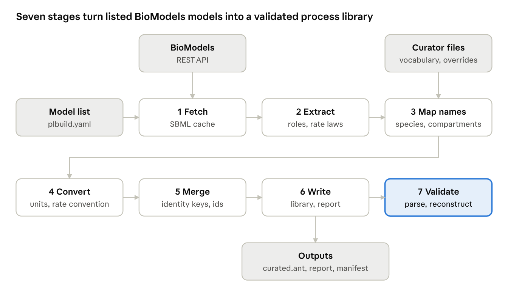

# EnsGen Process Library Builder — Specification

Nov 19, 2026 · Herbert Sauro

## 1. Purpose and scope

The Process Library Builder (`plbuild`) is an offline tool that turns a chosen set of BioModels models into the curated process-library file EnsGen loads. Each reaction becomes one process, with its species mapped to a shared vocabulary, its compartments mapped to EnsGen's fixed compartments, its rate law converted to EnsGen's units and rate convention, and its provenance recorded.

In scope:

- Fetching and caching SBML from BioModels.
- Extracting reactions, rate laws and parameters.
- Mapping species and compartment names to a shared vocabulary, with a manual override file for what annotations cannot resolve.
- Unit conversion and conversion to EnsGen's rate convention.
- Merging the same process found in several models.
- Writing the library, a vocabulary file, a build report and a manifest.
- Validating the output, including rebuilding source models from the extracted processes.

Out of scope:

- Anonymous processes; EnsGen ships those itself.
- Running EnsGen or any evolution.
- A graphical curation interface; curation is done by editing text files.

The file format is the restricted Antimony subset defined in section 5 of the EnsGen specification; this document does not redefine it.

## 2. Inputs and outputs

The builder reads a short list of hand-maintained text files and writes four output files; everything it needs is in version control except the SBML cache.

| Input | Format | Maintained by | Content |
| --- | --- | --- | --- |
| `plbuild.yaml` | YAML | Curator | Model list, compartments, unit standards, options |
| `vocabulary.yaml` | YAML | Curator | Canonical entities: name, class, unit, identifiers, synonyms |
| `overrides.yaml` | YAML | Curator | Per-model fixes: species and compartment mappings, excluded reactions, bounds |
| SBML cache | SBML files | Tool | Downloaded models, keyed by BioModels id and version |

| Output | Format | Content |
| --- | --- | --- |
| `curated.ant` | Restricted Antimony | The process library EnsGen loads |
| `vocabulary.used.yaml` | YAML | The entities the library actually uses |
| `report.json` and `report.html` | JSON, HTML | Per model: reactions found, kept, merged, excluded (with reason); unresolved names; unit conversions applied |
| `manifest.json` | JSON | Tool version, BioModels ids and versions, input-file hashes, output hash, build date |

The manifest makes a library reproducible: the same inputs and model versions produce a byte-identical `curated.ant`.

## 3. Pipeline overview

The builder runs seven stages in order; every stage records what it kept, changed or excluded, and the report collects those records.



Stages 1–6 run under `plbuild build`; stage 7 runs under `plbuild validate` and, by default, at the end of every build.

## 4. Selecting models from BioModels

The curator chooses the models; the tool does not search BioModels for them. A fixed, reviewed list keeps the library reproducible and keeps out models that do not fit the twin's scale.

- `plbuild.yaml` lists BioModels ids, each optionally pinned to a version. Unpinned ids resolve to the latest version at fetch time, and the manifest records the version used.
- `plbuild fetch` downloads the SBML through the BioModels REST API into the cache. A cached version is never downloaded again.
- By default only manually curated models are accepted; a non-curated model must be marked `allow_uncurated: true` in its list entry.
- A helper command, `plbuild search <terms>`, lists candidate models (id, name, curation status, species count) to help the curator build the list. It never edits the list itself.

Suitable models describe cell populations and soluble mediators at tissue or whole-body level (cytokine, cell-count and antibody dynamics). Intracellular signaling models mostly use compartments EnsGen does not have and will lose most of their reactions in section 7; the report shows this so the curator can drop them.

## 5. Extracting reactions

Each SBML reaction becomes one candidate process, unless it depends on something EnsGen cannot represent, in which case it is excluded with a reason in the report.

### Rate-law preparation

1. Inline function definitions.
2. Rename local parameters to `<reaction id>_<name>` and treat them like global ones.
3. Inline assignment rules whose right-hand side uses only constants, parameters and species. A rule that depends on another rule is inlined recursively.
4. Replace initial assignments of parameters by their computed values.

The expression text keeps the source's structure: names are substituted, but the expression is not rewritten or simplified, except for removing a compartment factor (section 8). This keeps rate laws in the form the modeller wrote, which is usually the conventional form.

### Species roles

| Source | Role in the process |
| --- | --- |
| Reactant | Consumed, with its stoichiometry |
| Product | Produced, with its stoichiometry |
| Modifier, or any species in the rate law that is neither reactant nor product | Influencing (not consumed) |
| Reactant or product marked boundary or constant | Influencing; removed from the stoichiometry, kept in the rate law |

### Exclusion rules

A reaction is excluded when its rate law, after preparation, contains any of the following:

| Cause | Reason code |
| --- | --- |
| `time`, `delay` or `piecewise` | `time_dependent` |
| A function outside `+ - * / ^`, `exp`, `log`, `sqrt`, `pow`, `abs`, `min`, `max` | `unsupported_function` |
| A parameter changed by an event, rate rule or algebraic rule | `dynamic_parameter` |
| An assignment rule that depends on time or on a dynamic parameter | `dynamic_rule` |
| Stoichiometry set by a rule or event | `stoichiometry` |
| A species that cannot be mapped (section 6) | `unmapped_species` |
| A compartment that cannot be mapped (section 7) | `unmapped_compartment` |
| Units that cannot be resolved (section 8) | `units` |
| Listed in `overrides.yaml` as excluded | `curator_excluded` |

Excluded reactions are still listed in the report, so the curator can fix the cause and rebuild.

## 6. Entity vocabulary and name mapping

Every species in the library must name an entity from one shared vocabulary; this is what lets processes from different models connect, and what lets EnsGen match model species to the observed data.

### Vocabulary file

Each entity has a canonical name (a valid Antimony identifier), a class, the unit its concentrations use, its database identifiers and its synonyms. Molecules measured in mass units also carry a molar mass, needed to convert from molar source units (e.g. nM to pg/mL).

```yaml
IL6:
  class: molecule
  unit: pg/mL
  molar_mass: 20900   # g/mol, used for molar conversions
  identifiers:
    - http://identifiers.org/uniprot/P05231
  synonyms: [IL-6, interleukin 6, interleukin-6, il6]
CD4_T:
  class: cell
  unit: cells/uL
  identifiers:
    - http://identifiers.org/cl/CL:0000624
  synonyms: [CD4+ T cell, Th, helper T cell, T4]
```

The observed species names agreed with the data providers must be entries in this file, under exactly the names the data use.

### Matching order

Each SBML species is matched in this order; the first match wins:

1. **Override:** an entry in `overrides.yaml` for this model and species id.
2. **Annotation:** a `bqbiol:is` identifier that appears in an entity's `identifiers`. `bqbiol:isVersionOf` and `bqbiol:hasVersion` count only when exactly one entity matches.
3. **Synonym:** the species name, then its id, normalized (lower case; spaces, hyphens and underscores removed; Greek letters spelled out, e.g. α → alpha) and compared with the normalized canonical name and synonyms.

A species that matches more than one entity, or none, is unresolved. The report lists every unresolved species with its name, id and annotations, so the curator can add a synonym, an identifier or an override.

### Complexes

A species annotated with `bqbiol:hasPart` for two or more entities maps to a complex entity named by joining the parts in alphabetical order with `_` (e.g. `IL6_IL6R`). The curator adds complex entities to the vocabulary like any other.

### Species ids in the library

A species id in `curated.ant` is the canonical entity name followed by `_` and the EnsGen compartment name, e.g. `IL6_blood`. This matches the observed species ids EnsGen expects.

## 7. Compartment mapping

Every SBML compartment used by a kept reaction must map to one of EnsGen's fixed compartments, which `plbuild.yaml` declares with the same names the EnsGen host uses.

```yaml
compartments:
  blood:
    identifiers: [http://identifiers.org/uberon/UBERON:0000178]
    synonyms: [blood, plasma, serum, circulation, central]
  tissue:
    identifiers: [http://identifiers.org/uberon/UBERON:0000479]
    synonyms: [tissue, peripheral, interstitium, site of infection]
  lymph_node:
    identifiers: [http://identifiers.org/uberon/UBERON:0000029]
    synonyms: [lymph node, LN, lymphoid tissue]
```

Matching follows the same order as species: override, then annotation, then normalized synonym. A model with a single, unannotated compartment (common in BioModels) maps to the compartment set by that model's `default_compartment` in `plbuild.yaml`; there is no global default, so the curator decides this per model.

Compartments such as cytoplasm, nucleus or cell membrane have no EnsGen counterpart. Reactions in them are excluded with `unmapped_compartment` unless the curator maps them explicitly.

Source compartment volumes are not carried into the library: EnsGen uses its own configured volumes. Their only use is in converting rate laws (section 8).

## 8. Units and rate-law conversion

Every process in the library uses one time unit and each entity's own concentration unit from the vocabulary, and its rate law gives concentration per time in its reaction compartment (EnsGen specification, section 5). The builder converts each source rate law to that form.

### Library units

- Time: one unit for the whole library, set in `plbuild.yaml` (hours for now).
- Concentration: each entity's `unit` in the vocabulary, e.g. pg/mL for cytokines, cells/µL for cell types.

### Source units

Source units come from the SBML unit definitions. Many BioModels models declare none; for those the curator gives them per model in `overrides.yaml` (substance, volume and time units). A model whose units remain unknown has all its reactions excluded with `units`. Unit arithmetic uses pint.

### Step 1: remove the compartment factor

SBML kinetic laws give amount per time. If the rate law is a product with the reaction compartment's symbol as a top-level factor, that factor is removed. Otherwise the expression is divided by the compartment's source volume, a constant, and the report notes `compartment_divided`.

### Step 2: convert units

Let s_X be the factor from source to library concentration units for species X (C_lib = s_X · c_src), and k_t the number of source time units per library time unit. Two methods, tried in order:

1. **Parameter conversion.** When every parameter in the rate law has declared units, convert the parameter values and leave the expression unchanged. This keeps the rate law readable.
2. **Substitution.** Otherwise, substitute X → (X/s_X) for each species and multiply the whole expression by k_t · s_ref, where ref is the reaction's reference species (first consumed, else first produced). Parameter values are left as in the source. The report notes `scaled_expression`.

Both give the same numbers; method 2 is exact without needing parameter units, at the cost of constant factors in the expression.

```latex
r_{\mathrm{lib}}(C) = k_t \, s_{\mathrm{ref}} \; r_{\mathrm{src}}\!\left( \frac{C_1}{s_1}, \ldots, \frac{C_n}{s_n} \right)
```

### Step 3: species with different units in one reaction

The rate is expressed in the reference species' units. Each other consumed or produced species Y gets its stoichiometric coefficient multiplied by s_Y / s_ref, so that, for example, a cell population producing a cytokine adds the right amount in pg/mL. This needs EnsGen to accept non-integer stoichiometric coefficients (open question in section 15).

## 9. Parameters and bounds

Each process carries its source parameter values (converted if section 8 method 1 applied) and log-scale bounds that EnsGen uses for random starts and to clamp mutation.

| Case | Bounds written |
| --- | --- |
| Default | value ÷ `bounds.factor` to value × `bounds.factor` (default factor 100) |
| Parameter named as a Hill coefficient in `overrides.yaml`, or matching `n`, `h`, `nH` | [1, 4], widened to include the source value if it lies outside |
| Value is 0 or negative | Reaction excluded with `parameter_value`, unless the curator gives bounds |
| Curator override | As given in `overrides.yaml` |
| Merged process (section 10) | Geometric mean of source values; bounds widened to cover every source value ÷ and × 10 |

Parameter names in the library are the source names, made unique within the entry. EnsGen renames them again when it inserts a process into a model.

## 10. Deduplication and process identity

The same process often appears in several models, such as IL-6 clearance from blood; the builder merges these into one entry so mutation does not favour processes simply because many models repeat them.

### Identity key

Two candidate processes are the same when their keys are equal. The key is:

- the consumed, produced and influencing species (canonical ids, with stoichiometry), and
- the rate-law form: the expression with each species replaced by a role token and each parameter by a positional token, put in a canonical form with SymPy.

So `k*IL6_blood` and `kdeg*IL6_blood` from two models share a key, while `Vm*S/(Km + S)` and `k*S` do not.

### Merging

A merged entry keeps one expression (from the first source in list order), lists every source in its own `// @source` line, and takes parameter values and bounds as in section 9.

### Process ids

The id is `P_` followed by the first 10 hexadecimal characters of the SHA-256 hash of the identity key, so a process keeps the same id when the library is rebuilt or other models are added. Entries in `curated.ant` are sorted by id, which makes rebuilds produce identical files.

## 11. Output files and report

`curated.ant` is the only file EnsGen reads; the others are for the curator and for reproducibility.

### `curated.ant`

A header comment (tool version, build date, manifest hash, library time unit), then one entry per process in the EnsGen format, sorted by id. A merged entry from two models:

```
// @process P_3f9a07c21e
// @kind curated
// @source BIOMD0000000aaa:J4
// @source BIOMD0000000bbb:R12
IL6_blood in blood
IL6_blood identity "http://identifiers.org/uniprot/P05231"
J: IL6_blood => ; kdeg*IL6_blood
kdeg = 0.41
// @bounds kdeg 0.0041 41
```

### Report

`report.json` holds, for each model: its id, version and name; counts of reactions found, kept, merged and excluded; each excluded reaction with its reason code; each unresolved species and compartment with its name, id and annotations; and each conversion applied (`compartment_divided`, `scaled_expression`, unit factors). Totals across models come first. `report.html` shows the same content as tables, sorted so the models losing the most reactions come first.

### Exit status

`plbuild build` exits 0 when it writes a library, even if reactions were excluded, and non-zero when an input file is malformed, a fetch fails, or validation fails. `--strict` also fails the build if any species is unresolved.

## 12. Validation

`plbuild validate` runs after every build. Its strongest check rebuilds each source model from the extracted processes and confirms that it simulates the same as the original.

| Check | Pass condition |
| --- | --- |
| EnsGen parser | `curated.ant` loads with EnsGen's own parser (`ensgen_harness --check-library`) without errors |
| Antimony | Every entry loads in libAntimony on its own |
| Vocabulary | Every species id in the library is a vocabulary entity plus a configured compartment |
| Bounds | Every parameter has lower < value < upper, all positive |
| Reconstruction | See below |

### Reconstruction test

For each source model whose reactions were all kept:

1. Simulate the original SBML with libRoadRunner over its own time span, using its own initial values.
2. Assemble a model from the library entries that came from it, using the source parameter values (not merged ones), the source initial values converted to library units, and the source compartment volumes. Each rate is written as an SBML kinetic law by multiplying it by its reaction compartment's volume.
3. Simulate it with libRoadRunner and convert the result back to source units.
4. Pass if every species agrees within 1e-6 relative (plus an absolute floor of 1e-12 times the species' maximum).

This tests species roles, compartment removal, unit conversion and stoichiometry scaling together. A model that fails is reported with the first species and time that disagree.

Models with excluded reactions cannot be fully rebuilt; for them the test runs on the subset of reactions kept, comparing only rates (not trajectories) at the source initial state.

## 13. Implementation and command line

`plbuild` is a Python package with a command-line entry point. Python fits here because the tool runs offline, a few times per library release, and depends on libSBML, libAntimony and libRoadRunner, which all have mature Python bindings; nothing in it is on EnsGen's runtime path.

| Dependency | Use |
| --- | --- |
| python-libsbml | Reading SBML, annotations and units |
| antimony | Checking entries load |
| libroadrunner | Reconstruction test |
| sympy | Rate-law canonical forms for identity keys |
| pint | Unit conversion |
| pyyaml, requests | Input files, BioModels REST API |
| pytest | Tests |

### Commands

| Command | Action |
| --- | --- |
| `plbuild search <terms>` | List candidate BioModels models; changes nothing |
| `plbuild fetch` | Download listed models into the cache |
| `plbuild build` | Extract, map, convert, merge; write `curated.ant`, vocabulary, report, manifest |
| `plbuild validate` | Run the checks of section 12 on the current output |
| `plbuild explain <model> <reaction>` | Show how one reaction was handled, step by step |

All commands take `--config plbuild.yaml`. `build` runs `validate` unless `--no-validate` is given.

### Package layout

| Module | Responsibility |
| --- | --- |
| `fetch` | BioModels API and cache |
| `extract` | SBML reading, rate-law preparation, species roles, exclusions |
| `mapping` | Vocabulary, overrides, species and compartment matching |
| `units` | Compartment-factor removal, unit conversion, stoichiometry scaling |
| `identity` | Identity keys, merging, ids |
| `writer` | `curated.ant`, report, manifest |
| `validate` | Checks and the reconstruction test |

## 14. Milestones and tests

The builder is seven milestones, each a Claude Code task done when its tests pass. Unit tests use small hand-written SBML fixtures, one per case, so they never need the network; one integration milestone uses real BioModels models.

| Milestone | Delivers | Needs |
| --- | --- | --- |
| L0 | Package skeleton, config loading, CLI stubs, CI | — |
| L1 | Fetch and cache, `search` | L0 |
| L2 | Reaction extraction and exclusion rules | L0 |
| L3 | Vocabulary, overrides, species and compartment mapping | L2 |
| L4 | Units, compartment factor, stoichiometry scaling | L3 |
| L5 | Identity keys, merging, writer, report, manifest | L4 |
| L6 | Validation, reconstruction test, first real library | L5, EnsGen M2 |

### L0 — Skeleton

- [ ] `plbuild --help` lists all commands
- [ ] Malformed `plbuild.yaml`, `vocabulary.yaml` and `overrides.yaml` each fail with the file and line
- [ ] CI runs pytest on Linux, Windows and macOS

### L1 — Fetch

- [ ] A pinned id and version downloads once; a second fetch uses the cache (recorded HTTP responses, no network)
- [ ] An unpinned id records the resolved version in the manifest
- [ ] A non-curated model is refused unless `allow_uncurated` is set

### L2 — Extraction

- [ ] Fixtures for each role rule (reactant, product, modifier, species in rate law only, boundary reactant) give the roles in section 5
- [ ] Function definitions, local parameters, assignment rules and initial assignments are resolved; the expression text is otherwise unchanged
- [ ] One fixture per exclusion reason code produces exactly that code

### L3 — Mapping

- [ ] Override, annotation and synonym matching each resolve a fixture species, and the first match wins when several apply
- [ ] Ambiguous and unmatched species are reported as unresolved
- [ ] Normalization: `IL-6`, `IL_6`, `il 6` and `Interleukin-6` all match `IL6` when listed as synonyms
- [ ] A `hasPart` complex maps to the alphabetical joined name
- [ ] A single unannotated compartment uses the model's `default_compartment`; a cytoplasm compartment is excluded

### L4 — Units

- [ ] `V*k*S` loses its compartment factor; `k*S` with no factor is divided by the volume and reported
- [ ] Parameter conversion and substitution give the same rate within 1e-12 relative on fixtures where both apply
- [ ] Minutes to hours and nM to pg/mL conversions match hand-computed values
- [ ] A cell-produces-cytokine fixture gets the stoichiometry factor s_Y / s_ref
- [ ] A model with no units and no override is excluded with `units`

### L5 — Merging and output

- [ ] `k*X` and `kdeg*X` merge; `Vm*X/(Km + X)` and `k*X` do not
- [ ] Merged values are geometric means; bounds cover every source value ÷ and × 10
- [ ] Ids are stable when an unrelated model is added to the list
- [ ] Two builds from the same inputs give byte-identical `curated.ant` and identical manifest hashes
- [ ] The report counts match the fixture set

### L6 — Validation and first library

- [ ] `curated.ant` loads in EnsGen's parser and every entry loads in libAntimony
- [ ] Reconstruction passes for every fixture model, including a two-compartment and a mixed-unit one
- [ ] A deliberately broken conversion (factor off by 10) makes reconstruction fail with the species and time named
- [ ] First real library built from an agreed list of 5–10 immune models; report reviewed with the curator

## 15. Open questions

- [ ] **Non-integer stoichiometry in EnsGen.** Section 8 step 3 needs EnsGen to accept real stoichiometric coefficients. The EnsGen spec should state this explicitly (its section 5).
- [ ] **Library units.** Time is hours for now. Each entity's concentration unit must match the units the data arrive in; agree them with the data providers before L4.
- [ ] **Python.** Resolved: Python is acceptable for this offline tool.
- [ ] **First model list.** Which 5–10 BioModels models form the first library.
- [ ] **Compartments.** Confirm blood, tissue and lymph node as the v1 set, and their names, so they match the EnsGen host configuration.
- [ ] **Intracellular models.** Exclude them (default), or map selected intracellular reactions onto a tissue compartment case by case?
- [ ] **Vocabulary ownership.** Who maintains `vocabulary.yaml`, since the data providers' observable names must appear in it.
